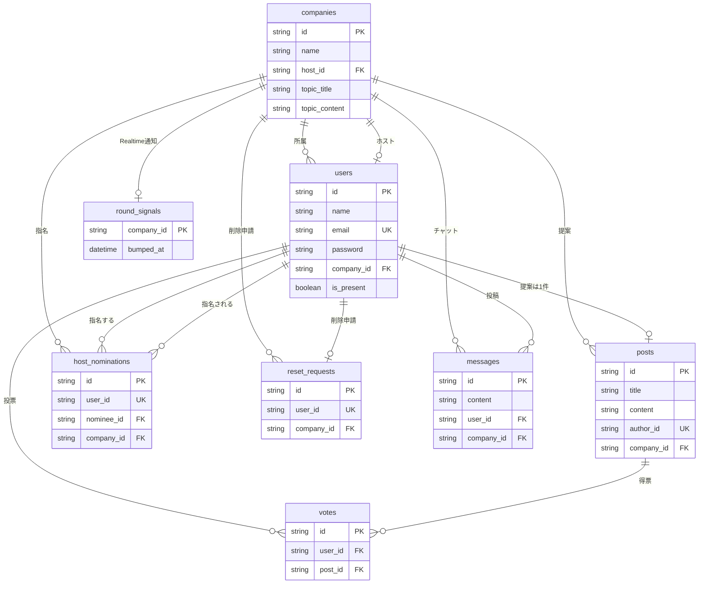

# Fast Vote

同じ会社のメンバーが提案を出し、**全員が出し終わってから**投票する Web アプリです。

- 毎回 **ホストを指名** し、ホストが **お題** を出す
- 提案は **1人1件**
- 投票は **同じ会社の全員が提出したあと** に開始
- 投票は他の人の提案から **1件または2件**（自分の提案には投票できない。送信後は変更不可）
- この回に提案したメンバー全員の削除申請でホスト・お題・提案・票・チャットを初期化する
- 同じ会社の画面は **リロードなし** で進む（Supabase Realtime。定期ポーリングはしない）
- 作業中に同じ会社のメンバーと **チャット** できる
- ログアウトするとメンバー一覧からは外れるが、出した提案と入れた票は残る（アカウントも残る）
- 新規登録で **氏名またはニックネーム** を入れ、ヘッダーのアイコン横に出す
- ホーム画面に追加できる **PWA**（ブラウザの「アプリをインストール」／「ホーム画面に追加」）
- タブ・PWA・ヘッダーのマークは同じ **FV** アイコン

---

## 開発の目的・ターゲット層

**目的**は、「アイデアを集める」と「決める」を同じ流れで完結させることです。よくあるアンケートツールだと、誰かが未提出のまま投票が始まり、結果が偏ります。Fast Vote は会社単位で提出状況を見せ、揃うまで投票を閉じることで、少人数でも公平に選べるようにしています。

**想定している利用者**は、次のような人たちです。

| 層                           | どういう場面か                                               |
| ---------------------------- | ------------------------------------------------------------ |
| スタートアップや小規模チーム | 来期の施策・社内イベント案を、全員提出後に投票で絞る         |
| 学生のグループワーク         | 発表テーマや役割案を、メンバー全員が書いてから決める         |
| 勉強会・ハッカソンの運営     | 参加者（同じ「会社」＝同じグループ）の企画を集めて順位を出す |

大企業向けの本格的な人事システムや、不特定多数向けの公開投票サービスではありません。ログインした会社の中だけで完結する、小さな合意形成ツールです。

---

## 使用技術と選定理由

Web の案件でよく求められる組み合わせを、1つのリポジトリで最後まで動かすことを優先して選びました。

| 技術                              | 役割                                | なぜこれを選んだか                                                                                                                                                                               |
| --------------------------------- | ----------------------------------- | ------------------------------------------------------------------------------------------------------------------------------------------------------------------------------------------------ |
| **Next.js 14（App Router）**      | 画面と API を同じプロジェクトで提供 | フロントとサーバーを分けずに学習・実装できる。採用市場でも React / Next.js の案件が多い                                                                                                          |
| **TypeScript**                    | 型チェック                          | API のレスポンスと画面のデータの食い違いを、実行前に気づける                                                                                                                                     |
| **NextAuth（Credentials + JWT）** | ログイン                            | 会社名・氏名またはニックネーム・メール・パスワードで始められる。OAuth（Google など）に依存せず、社内ツールとして説明しやすい                                                                     |
| **bcrypt**                        | パスワードのハッシュ化              | パスワードをそのまま DB に置かないため                                                                                                                                                           |
| **Prisma 5**                      | DB アクセス                         | テーブル定義（`schema.prisma`）から TypeScript の型が生成され、クエリミスを減らせる                                                                                                              |
| **PostgreSQL（Supabase）**        | データベース                        | リレーショナル DB の標準に近く、外部キーやユニーク制約（1人1提案、重複投票禁止）を DB 側で守れる。ホスティングは無料枠のある Supabase を使い、本番に近い接続（コネクションプール）を経験するため |
| **Supabase Realtime**             | ダッシュボードの即時更新            | 指名・お題・提案・投票・削除申請・チャット・登録・ログインでも他メンバーの画面を更新する。公開キーは通知用テーブルだけ読める（RLS）。定期ポーリングは使わない                                    |
| **Tailwind CSS**                  | UI                                  | コンポーネントごとにクラスを書いて見た目を揃えやすく、デザイン専用の CSS ファイルを増やさない                                                                                                    |
| **PWA（Web App Manifest + SW）**  | ホーム画面追加                      | アプリストアなしでスマートフォンやパソコンに置ける。アイコンはヘッダーと同じ FV（`app/favicon.ico` がタブ、`public/icons/` がホーム画面）。Service Worker はインストール要件を満たす程度で、API はキャッシュしない |

データベースを SQLite のままにせず PostgreSQL にしたのは、「ローカルだけで動く練習」ではなく、実際の Web サービスで使う構成に近づけるためです。

---

## 開発中に苦労したエラーと、どう調べ・解決したか

ログに出た英文をそのまま貼るのではなく、**画面で何が起きたか → どこを見たか → 何が原因か → 何をしたか** の順で残しています。

### 1. 提案を提出できない（画面は出るが保存に失敗）

**症状**  
「自分の提案」でタイトルと内容を送ると、ブラウザの開発者ツールに `POST /api/proposals 500` と出る。取得 API も 500 になり、フォーム自体が出ないこともあった。

**調べ方**

1. ブラウザの Network タブで、失敗したリクエストのステータスが 500 であることを確認した
2. ターミナルの `npm run dev` ログを開き、Prisma が出しているメッセージを読んだ
3. 最初は `Unknown nested field 'proposal'`、直したあとは `Unknown argument authorId` と、エラーの中身が変わった

**原因**  
コードとデータベースの設計は「提案は User と 1対1（`authorId`）」に更新済みだった。一方で、起動中の Next.js は **古い Prisma クライアント** をメモリに残したまま動いていた。古い定義では投稿者が `PostUser` という中間テーブル経由で、`authorId` という列を知らなかった。

**解決**

- クエリを「`authorId` を直接指定」から「`author: { connect: { id } }`」のように、リレーション経由の書き方に揃えた
- `npx prisma generate` と `npx prisma db push` で、生成コードと DB をスキーマに合わせた
- Next.js が `@prisma/client` を古い状態でバンドルしないよう `next.config.mjs` に `serverComponentsExternalPackages` を追加した
- `.next` キャッシュを消して開発サーバーを再起動した

再起動後、`POST /api/proposals` は 200 になり、提出した提案が一覧と提出状況に出るようになった。

### 2. リロードすると白い画面になる

**症状**  
ログインしたあとページを更新すると、一瞬真っ白になり、トップとダッシュボードを行き来して見える。

**調べ方**  
ログイン済みかどうかを見る `middleware` と、クライアント側で `/dashboard` へ飛ばす処理が **両方** 動いていないかを追った。開発者ツールの Network で `/` と `/dashboard` が連続して 200 / リダイレクトされているかを確認した。

**原因**  
サーバー（middleware）とブラウザ（`useEffect` での画面遷移）が、同じ「ログインしている / していない」判定を別々に行い、リダイレクトがループしていた。

**解決**  
認証の振り分けは middleware に一本化し、クライアントからは同じ判定で bounce しないようにした。Header などセッションに依存する部品は、マウント後に描画して hydration の不一致も避けた。

### 3. Prisma の URL エラーと、Studio が起動しない

**症状**

- エディタ上で「datasource に url が必要」といった Prisma 7 向けの指摘が出る
- `npx prisma studio` が権限エラー（EPERM）で落ちる

**調べ方**  
`package.json` の Prisma バージョンを確認した（このプロジェクトは **5.13.0**）。エラーメッセージの「Prisma 7」は、エディタの拡張機能が新しいメジャーを想定しているだけで、実行中の CLI とは別だった。Studio はサンドボックス制限のログも併せて読んだ。

**原因**

- スキーマの書き方は Prisma 5 のままで正しく、IDE の診断だけが先行していた
- Studio はローカルのクエリエンジンバイナリを実行するため、制限された環境では起動に失敗する

**解決**  
実行は `npx prisma generate` / `db push` / `studio` をプロジェクトの Prisma 5 で行う。Supabase には **2本の接続 URL** が必要で、次のように分けた。

| 変数           | 用途                                                   |
| -------------- | ------------------------------------------------------ |
| `DATABASE_URL` | 通常のクエリ。ポート 6543 のプール（`pgbouncer=true`） |
| `DIRECT_URL`   | マイグレーションや `db push`。ポート 5432              |

Studio は制限のない環境で起動し、テーブルの中身を確認した。

### 4. 最後の削除申請が 504 で失敗する

**症状**  
投票後、最後の人が「削除申請する」を押すと、ブラウザに `POST /api/reset-request 504 (Gateway Timeout)` と出る。続けて `Unexpected token 'A' ... is not valid JSON` も出る。途中の申請は通る。

**調べ方**  
Network タブで、失敗した応答の本文が JSON ではなく `An error occurred...` のような HTML / テキストであることを確認した。504 はアプリの 500 ではなく、Vercel 側が待つのを打ち切った印。

**原因**  
最後の申請だけ、提案・チャットなどをまとめて消す処理が走る。その処理を Prisma の `$transaction` で包んでいた。本番の `DATABASE_URL` は Supabase の PgBouncer（ポート 6543）なので、対話的なトランザクションが待ち続け、Hobby プランの時間制限（約10秒）で 504 になる。ブラウザは JSON でない本文を `res.json()` しようとして SyntaxError になっていた。

**解決**

- 初期化は `$transaction` を使わず、削除を順に実行する（票は提案削除の Cascade で消える）
- 申請 API は状況の再取得を重ねない
- 504 のときは JSON として読まず、申請が揃っていれば「初期化をやり直す」を出せるようにした

### 5. localhost で Realtime が動かないように見える

**症状**  
別の人が提案を出しても、自分の画面がすぐ変わらない。

**調べ方**  
開発サーバーをキー設定のあとに再起動したか、ダッシュボードを **別ユーザーの2タブ** で開いているかを確認した。ブラウザのコンソールに `Supabase Realtime: CHANNEL_ERROR` が出ていないかも見た。

**原因**  
`NEXT_PUBLIC_` の値は Next.js 起動時にフロントへ埋め込まれる。サーバーを上げ直していないと購読しない。また、操作した本人の画面は API 応答で更新されるので、Realtime の効果は **他の人が開いている画面** で分かる。

**解決**  
`.env.local` に公開 URL / キーを入れたうえで `npm run dev` を再起動する。Publications に `round_signals` があり、Realtime が Enabled なら、同じ公開キーで購読できる。

---

## できること

| 画面                | 内容                                                                             |
| ------------------- | -------------------------------------------------------------------------------- |
| 新規登録 / ログイン | 会社名・氏名またはニックネーム・メール・パスワードで参加。既存の会社名ならそこに入る |
| ホスト・お題        | メンバーがホストを指名し、ホストがお題を出す                                     |
| 自分の提案          | お題に沿って1件提出。提出後は得票を確認                                          |
| 提出状況            | 同じ会社の誰が提出・投票済みか                                                   |
| 投票する            | 全員提出後に1件か2件選んで投票（送信後は変更不可）                               |
| 得票（上位5）       | 自社のランキング（同票は同じ順位）                                               |
| チャット            | 同じ会社のメンバーと作業中に会話する（ダッシュボード右／狭い画面では折りたたみ） |

---

## データベース構成

PostgreSQL（Supabase）。テーブル名は Prisma の `@@map` どおりです。会社を消すと、所属ユーザーとラウンドデータもまとめて消えます（`onDelete: Cascade`）。この回に提案したメンバーの削除申請が揃うと、ホスト・お題・指名・提案・票・チャットを消して次の回に戻します。

### companies（会社）

| カラム        | 型      | 制約                  | 意味                           |
| ------------- | ------- | --------------------- | ------------------------------ |
| id            | String  | PK                    | 会社 ID                        |
| name          | String  |                       | 会社名（同じ名前なら同じ会社） |
| host_id       | String? | UNIQUE, FK → users.id | 今ラウンドのホスト             |
| topic_title   | String? |                       | ホストが出したお題             |
| topic_content | String? |                       | お題の説明                     |

### users（参加者）

| カラム         | 型        | 制約              | 意味                                                               |
| -------------- | --------- | ----------------- | ------------------------------------------------------------------ |
| id             | String    | PK                | ユーザー ID                                                        |
| name           | String?   |                   | 氏名またはニックネーム（ヘッダーのアイコン横）                     |
| email          | String?   | UNIQUE            | ログイン用                                                         |
| email_verified | DateTime? |                   | 未使用（予約）                                                     |
| image          | String?   |                   | 未使用（予約）                                                     |
| password       | String    |                   | ログイン用                                                         |
| company_id     | String?   | FK → companies.id | 所属会社                                                           |
| is_present     | Boolean   | default false     | ログイン中ならメンバー一覧に含める。ログアウトしても提案と票は残る |

### posts（提案）

| カラム     | 型       | 制約                  | 意味             |
| ---------- | -------- | --------------------- | ---------------- |
| id         | String   | PK                    | 提案 ID          |
| title      | String   |                       | タイトル         |
| content    | String   |                       | 本文             |
| author_id  | String   | UNIQUE, FK → users.id | 提案者（1人1件） |
| company_id | String?  | FK → companies.id     | 所属会社         |
| created_at | DateTime |                       | 作成日時         |
| updated_at | DateTime |                       | 更新日時         |

### votes（投票）

| カラム  | 型     | 制約          | 意味         |
| ------- | ------ | ------------- | ------------ |
| id      | String | PK            | 票 ID        |
| user_id | String | FK → users.id | 投票した人   |
| post_id | String | FK → posts.id | 投票先の提案 |

`@@unique([user_id, post_id])` で、同じ提案への二重投票を防ぎます。1人あたり最大2件です。

### host_nominations（ホスト指名）

| カラム     | 型       | 制約                  | 意味                 |
| ---------- | -------- | --------------------- | -------------------- |
| id         | String   | PK                    | 指名 ID              |
| user_id    | String   | UNIQUE, FK → users.id | 指名した人（1人1票） |
| nominee_id | String   | FK → users.id         | 指名された人         |
| company_id | String   | FK → companies.id     | 対象の会社           |
| created_at | DateTime |                       | 指名日時             |

全員が指名し、最多が1人に決まると `companies.host_id` に入ります。

### reset_requests（削除申請）

| カラム     | 型       | 制約                  | 意味                 |
| ---------- | -------- | --------------------- | -------------------- |
| id         | String   | PK                    | 申請 ID              |
| user_id    | String   | UNIQUE, FK → users.id | 申請した人（1人1回） |
| company_id | String   | FK → companies.id     | 対象の会社           |
| created_at | DateTime |                       | 申請日時             |

会社の人数分揃うと、ホスト・お題・指名・提案・票・チャットを消します。

### messages（会社チャット）

| カラム     | 型       | 制約              | 意味                |
| ---------- | -------- | ----------------- | ------------------- |
| id         | String   | PK                | メッセージ ID       |
| content    | String   |                   | 本文（最大500文字） |
| user_id    | String   | FK → users.id     | 投稿者              |
| company_id | String   | FK → companies.id | 対象の会社          |
| created_at | DateTime |                   | 投稿日時            |

1人何件でも書けます。本文は NextAuth 付き API 経由だけで読み、公開キーには載せません。

### round_signals（Realtime 通知）

| カラム     | 型       | 制約                  | 意味                     |
| ---------- | -------- | --------------------- | ------------------------ |
| company_id | String   | PK, FK → companies.id | 対象の会社               |
| bumped_at  | DateTime |                       | 最後に状況が変わった時刻 |

提案や票・チャット本文は載せない。指名・お題・提案・投票・削除申請・チャット投稿・新規登録・ログイン／ログアウトのたびにこの行だけ更新し、同じ会社のブラウザが状況 API とチャットを取り直す。

### ER図

---

## Realtime（リロードなしの更新）

定期的に API を叩くポーリングは使わない。ダッシュボードは次のときに `/api/company-status` を取り直す。

| きっかけ                       | 内容                                                      |
| ------------------------------ | --------------------------------------------------------- |
| 画面を開いたとき               | 最初の1回                                                 |
| タブを前面に戻したとき         | 裏にしていた間の変化を取り込む                            |
| 自分の操作の直後               | 指名・お題・提案・投票・削除申請・チャット投稿            |
| 他メンバーの操作               | Supabase が `round_signals` の変更を WebSocket で知らせる |
| 同じ会社への新規登録・ログイン | メンバー一覧や提出人数にすぐ反映する                      |
| ログアウト                     | メンバー一覧から外れる。提案・票は残る                    |

ログインは NextAuth のまま。ブラウザに出すのは公開キーだけで、提案・票・パスワードは Realtime に流れない。

## 使い方

1. トップで会社名・氏名またはニックネームを入れて新規登録する（名前はヘッダーのアイコン横に出る）
2. 「ホスト・お題」でメンバーを指名する。全員の指名が揃うとホストが決まる
3. ホストがお題を出す
4. 「自分の提案」から提案を提出する
5. 「提出状況」で同僚の提出を確認する
6. 全員が提出したら「投票する」が開く
7. 自分以外の提案から1件または2件選んで送信する（送信後は変更不可）
8. 「得票（上位5）」で結果を見る
9. この回に提案したメンバーが全員削除申請すると、ホスト・お題・提案・票・チャットが消え、次の回（ホスト指名から）に戻る
10. ダッシュボードのチャットで、同じ会社のメンバーと会話できる（パソコンでは右、スマートフォンでは「開く」）
11. スマートフォンのブラウザから「ホーム画面に追加」、パソコンの Chrome などから「アプリをインストール」すると、単体アプリのように開ける（タブもホーム画面も FV アイコン）
